# Assignment & Review Dashboard — Round 2

Student, group and assignment management for two roles — **Student** and **Professor** — with login/register,
a simulated JWT session, course-based dashboards, group submissions and live submission tracking.

Built with **React 19 + TypeScript + Tailwind CSS v4** (Vite, React Router, Vitest). There is no backend: a
mock API over `localStorage` stores the data, so it survives a refresh.

- **Live demo:** _add your Vercel/Netlify link here_
- **Demo video:** _add your Loom / Drive link here_
- The app lives in [`/frontend`](./frontend).

## Demo logins

Password for every demo account: **`Demo@1234`** (the login page also has one-click fill buttons).

| Role | Name | Email | Good for |
|---|---|---|---|
| Professor | Prof. Rahul Verma | rahul.verma@university.edu | Web Development: group assignment tracking |
| Professor | Prof. Meera Iyer | meera.iyer@university.edu | Data Structures, Algorithms |
| Student | Kabir Singh | kabir.singh@student.edu | **Leader** of Byte Club: acknowledge the group assignment |
| Student | Isha Nair | isha.nair@student.edu | **Member** of Byte Club: sees "Acknowledged by Kabir Singh…" but cannot submit |
| Student | Rohan Gupta | rohan.gupta@student.edu | **No group** in Web Development: sees the "not part of any group" message |
| Student | Aarav Mehta | aarav.mehta@student.edu | Leader of Team Pixel (already acknowledged) |

You can also register a new Student or Professor. A new professor can create courses; a new student can enrol in them.
"Reset demo data" on the login page restores the seed data.

## Screenshots

| | |
|---|---|
| 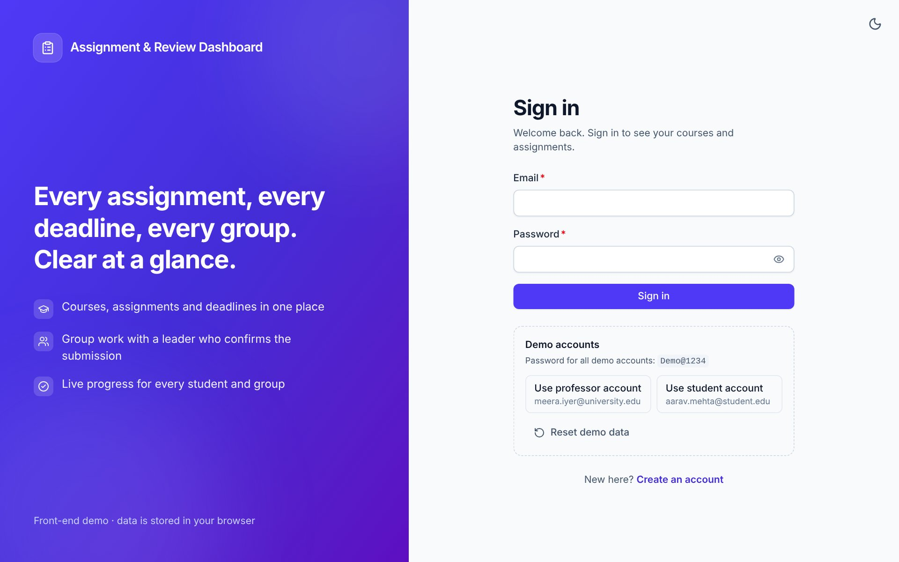 **Login** with demo accounts | 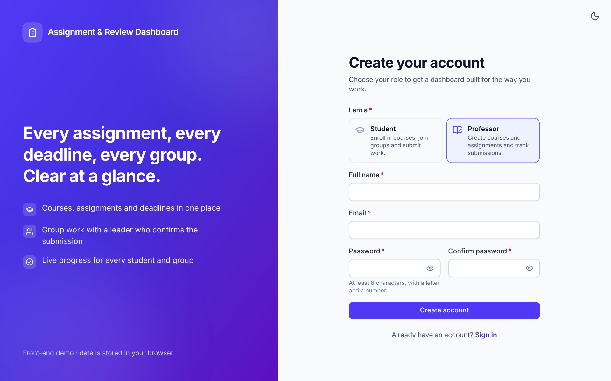 **Register** with role choice |
| 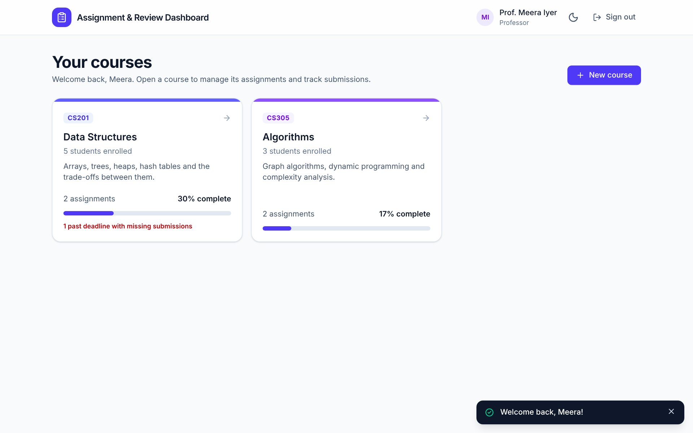 **Professor** course cards | 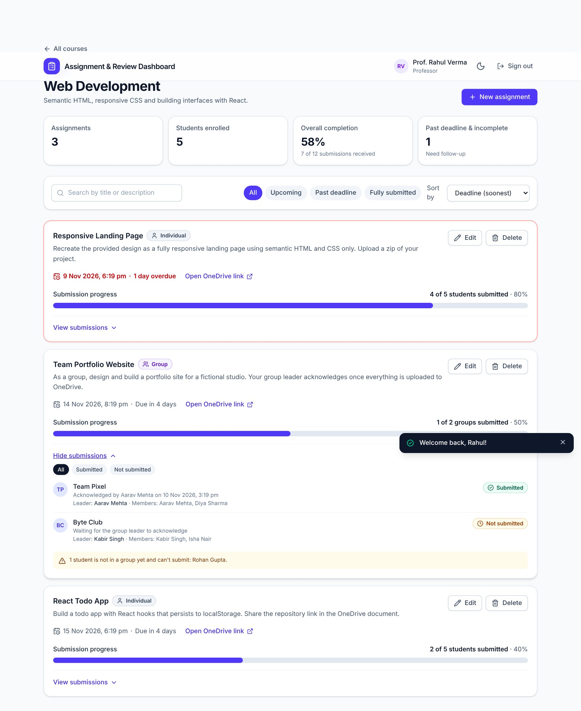 **Tracking**: progress, drill-down, ungrouped students |
| 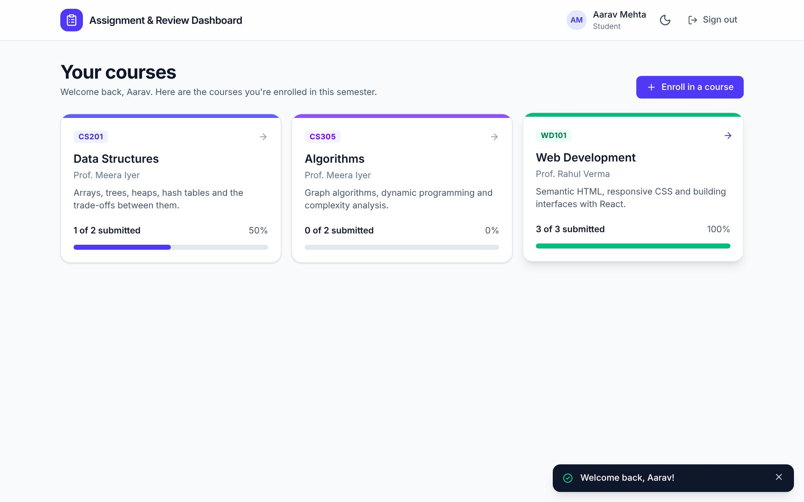 **Student** course cards | 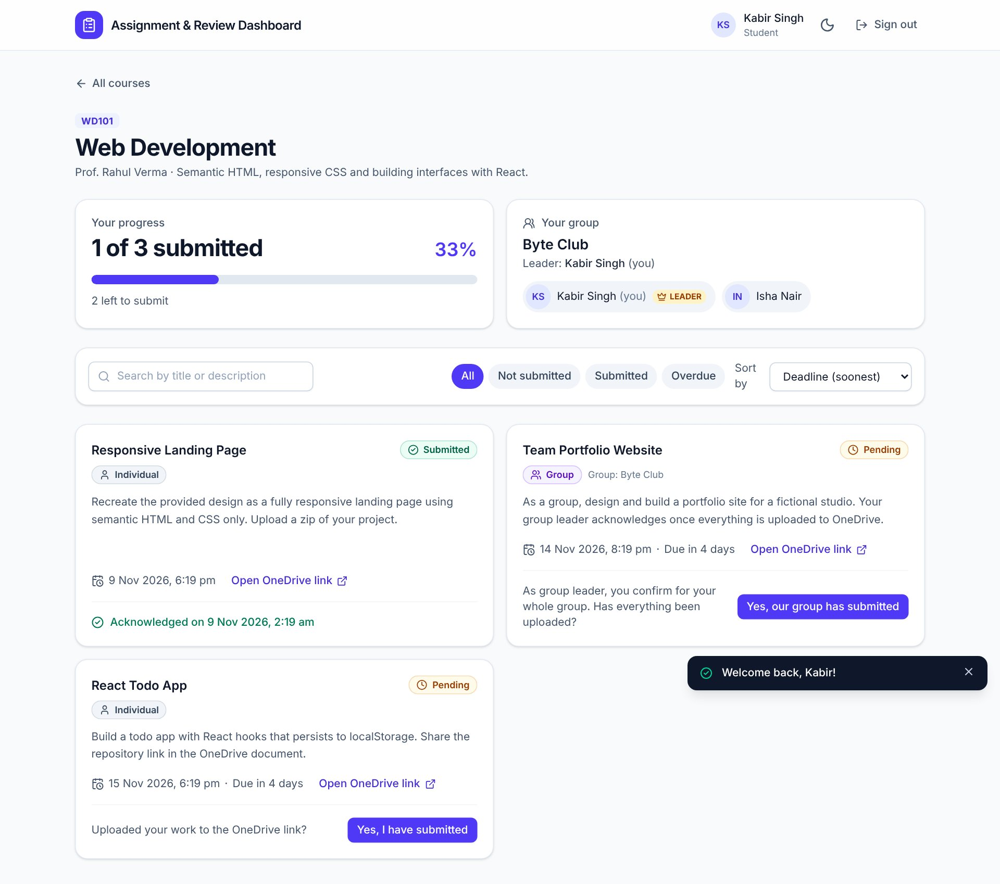 **Group leader** view |
| 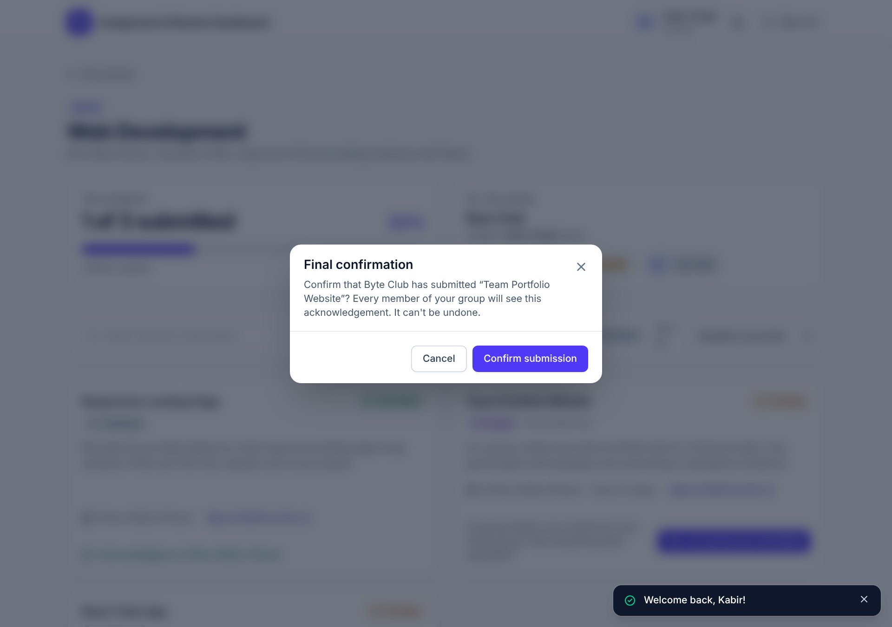 **Confirmation** before a group submission | 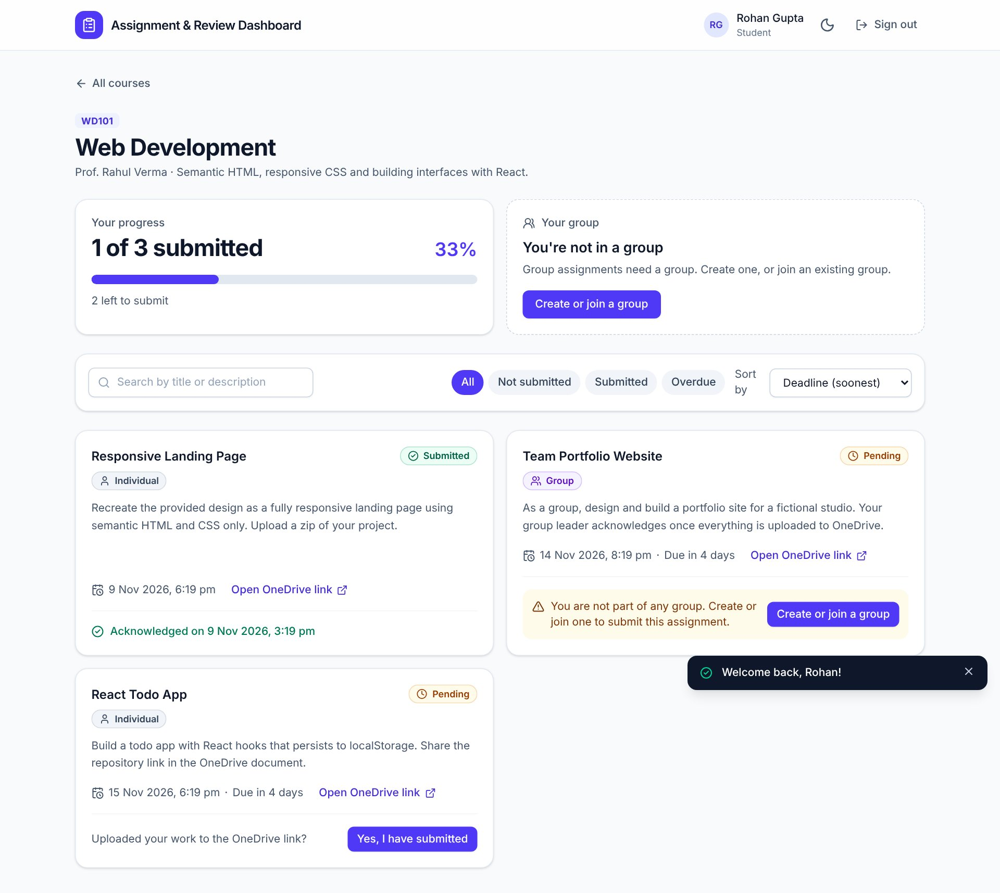 **No group** message and button |
| 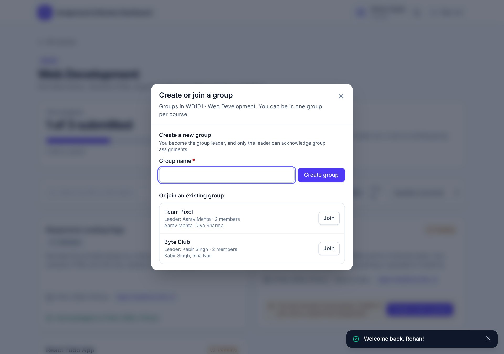 **Create or join** a group | 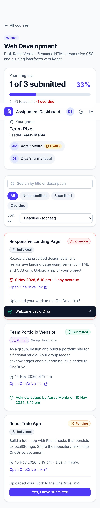 **Mobile** layout |
| 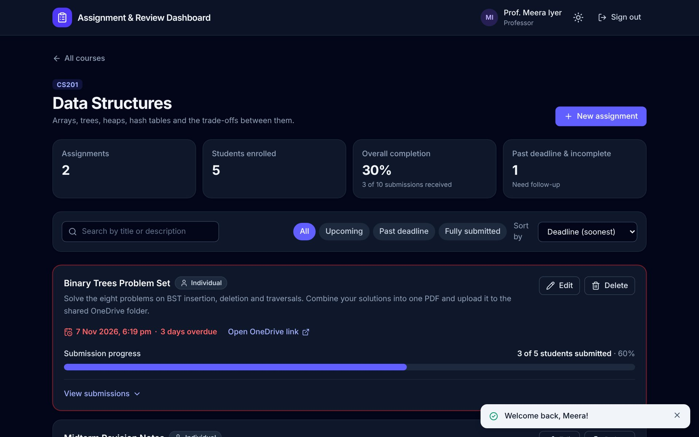 **Dark mode** | |

## Features

**Auth & session**
- Login and register with inline validation and clear messages (email format, password rules, matching passwords, role required).
- Register as Student or Professor; each role lands on its own dashboard.
- Simulated JWT: `header.payload.signature` stored in `localStorage`, verified on load, expires after 8 hours, cleared on logout.
- Protected routes: signed-out visitors go to login; a student cannot open `/professor/...` and vice versa.

**Professor**
- Dashboard of course cards, each opening that course's assignments page.
- Create, edit, delete assignments: title, description, deadline (**date and time**), OneDrive link, submission type (Individual / Group).
- Tracking per assignment: "x of N students (or groups) submitted", progress bar, and a drill-down of who has and has not submitted.
- Group assignments are tracked per group, with a warning listing students who are in no group.
- Search, status filters and sorting.

**Student**
- Dashboard of enrolled courses with progress; course page lists every assignment with deadline, OneDrive link, type and status.
- Individual: **"Yes, I have submitted"** → confirm → timestamp stored.
- Group: only the **leader** can acknowledge; afterwards every member sees **"Acknowledged by [Leader] on [date and time]"**.
- No group: "You are not part of any group. Create or join one to submit this assignment." with a button.
- Groups: create one (you become leader) or join one; members and leader are shown.

**Polish**
- Progress bars, status badges with icons, overdue highlighting, toasts, hover/focus states, transitions, loading skeletons/spinners, empty and error states.
- Fully responsive, dark mode, keyboard accessible, `prefers-reduced-motion` respected.

## Design choices

- **Rules live in the data layer, not just the UI.** `lib/rules.ts` holds pure functions (`acknowledgeAssignment`, `createGroup`, …) that return `{ ok: true, db } | { ok: false, error }`. The "only the leader can acknowledge" rule is enforced there, so the UI can't bypass it, and it is unit-tested without rendering anything.
- **Status is derived, never stored.** Whether something is submitted comes from acknowledgement records, so the student view, the group view and the professor's counts can't disagree.
- **Acknowledgements belong to a subject** (`student` or `group`), so group submissions need no special casing in the tracking code.
- **Course-based model.** Courses own assignments; students enrol themselves and professors create courses, so a newly registered user has a working app without any seeding.
- **One group per course; submission type is locked once anyone has acknowledged,** so existing submissions are never invalidated by an edit.
- **Mock API behind one module** (`lib/storage.ts`) with simulated latency, so it can be swapped for real HTTP calls later.
- **Accessibility first:** labelled forms, focus-trapped dialogs, `aria-live` toasts, status never shown by colour alone.

### Known limitations
- The JWT and password hash are **simulated** for the front-end exercise and give no real security. A real app would issue the token server-side.
- Data is per-browser (`localStorage`); there is no sync between devices.

## Component structure

```
App ── ThemeProvider ─ ToastProvider ─ DataProvider ─ AuthProvider ─ Routes
        │
        ├─ /login, /register            (PublicOnly)   → features/auth
        ├─ /professor                   (RequireAuth: professor)
        │    ├─ ProfessorDashboard      → CourseCard, CourseFormModal
        │    └─ courses/:courseId → ProfessorCoursePage
        │          ├─ FilterBar, StatTile
        │          └─ ProfessorAssignmentCard → ProgressBar, TrackingList, AssignmentForm
        └─ /student                     (RequireAuth: student)
             ├─ StudentDashboard        → CourseCard, EnrollDialog
             └─ courses/:courseId → StudentCoursePage
                   ├─ GroupPanel → GroupDialog (create / join)
                   └─ StudentAssignmentCard → StatusBadge, ConfirmDialog
```

```
frontend/src
├─ components/   ui/ (Button, Modal, ProgressBar, …) · layout/ · assignments/ · courses/ · routing/ (guards)
├─ context/      AuthContext (token + session) · DataContext (db + actions) · ThemeContext · ToastContext
├─ features/     auth/ · professor/ · student/ · common/
├─ lib/          rules.ts (business rules) · domain.ts (derived data) · token.ts · storage.ts · validation.ts · dates.ts
├─ data/         seed.ts
└─ test/         integration tests (auth, student, professor)
```

## Setup

```bash
cd frontend
npm install
npm run dev        # http://localhost:5173
npm test           # 96 tests (unit + integration)
npm run build      # type-check + production build into dist/
```

## Deploy (Vercel or Netlify)

The app uses client-side routing, so every path must fall back to `index.html`. Config is included
(`vercel.json`, `netlify.toml`, `public/_redirects`).

- **Vercel:** Import the GitHub repo → set **Root Directory** to `frontend` → framework *Vite* → Deploy.
- **Netlify:** New site from Git → set **Base directory** to `frontend` (build `npm run build`, publish `dist`) → Deploy.

## Git history

Round 1 history is preserved; Round 2 starts at "restructure into /frontend" and is split into small commits
(domain model → auth → login/register → professor flow → student flow → tests → docs).
